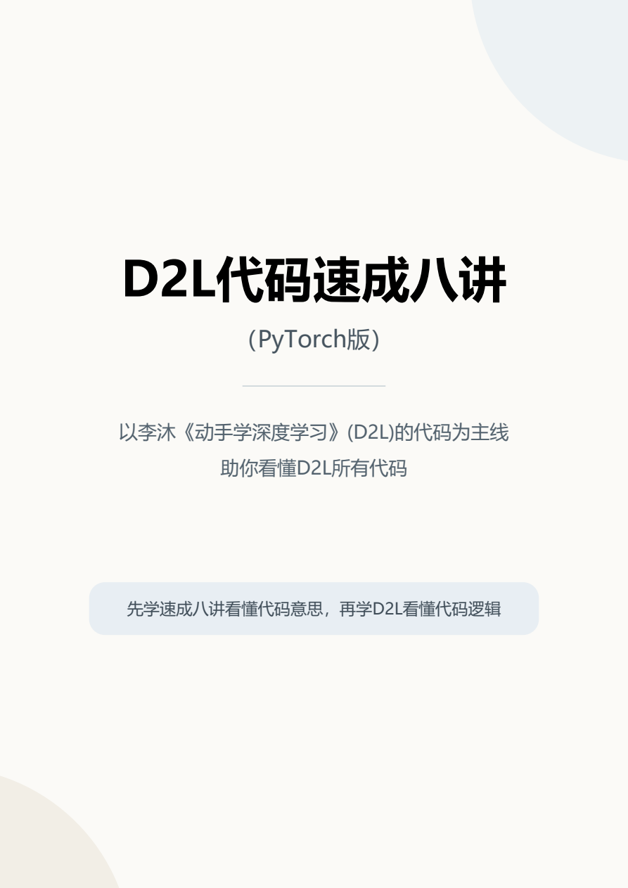

# D2L 课程笔记与基础速成教材（D2L Notes and Crash Course）

本仓库用于整理李沐老师的《动手学深度学习》（D2L）课程笔记和基础速成教材，帮助具备基础 Python 知识的读者尽快看懂常见代码、跟上课程。当前收录的八讲采用 **PyTorch** 版示例，可结合 [D2L 中文教材](https://zh.d2l.ai/) 和课程讲解阅读。

[D2L 课程介绍](#d2l-课程介绍) · [关于李沐老师](#关于李沐老师) · [课程与官方资源](#课程与官方资源) · [教材目录](#教材目录)

## 已收录资料：D2L 基础速成八讲（PyTorch 版）

[**在线阅读教材**](D2L-Crash-Course.pdf) · [**下载 PDF**](https://github.com/Needy1100/d2l-notes-and-crash-course/releases/latest/download/D2L-Crash-Course.pdf) · [查看教材目录](#教材目录)

  

这份教辅适合在开始学习 D2L 前熟悉常见代码，也可在学习途中查阅。内容从张量的形状和运算入手，讲到怎样准备数据、定义模型、计算梯度，以及完成训练和评估。

教材适合已经掌握基础 Python 语法、刚开始学习深度学习的读者。书中结合代码示例说明每一步在做什么、数据怎样流动，以及遇到形状或类型不匹配时从哪里查起。

**全书共八讲，PDF 共 61 页，正文单独编号，共 57 页。** 部分代码示例参考李沐等人编写的《动手学深度学习》（D2L）。

## D2L 课程介绍

《动手学深度学习》（**Dive into Deep Learning**，简称 **D2L**）是一套将理论、代码和练习放在一起的深度学习教材。李沐老师主讲的[中文在线课程 v2](https://c.d2l.ai/zh-v2/)配合教材第二版，使用 PyTorch 演示模型实现。课程适合有基础 Python 编程和数学知识、希望自己动手训练模型的学习者。

- **打基础**：从数据操作、线性代数和自动求导开始，通过线性回归、softmax 回归和多层感知机理解损失函数、反向传播和训练循环。
- **学模型**：进一步学习卷积神经网络、循环神经网络和注意力机制，理解不同网络为什么适合处理不同的数据。
- **做实践**：结合图像分类、目标检测、机器翻译等任务，练习把模型原理落实到数据处理、代码实现和结果评估中。

课程主页按讲次列出学习内容，并提供对应课件和视频入口。学习时可以先读教材，再运行例子验证自己的理解；如果卡在张量形状、参数含义或训练代码，可以回查本仓库的基础速成八讲。

## 关于李沐老师

李沐（Mu Li）是 D2L 中文在线课程的讲师，也是《动手学深度学习》的共同作者之一。他于 2017 年获得[卡内基梅隆大学计算机科学博士学位](https://csd.cmu.edu/academics/doctoral/degrees-conferred/mu-li)，博士研究涉及分布式机器学习中系统与算法的协同设计。[AWS 的研究者访谈](https://aws.amazon.com/blogs/machine-learning/in-the-research-spotlight-mu-li/)介绍了他在大规模机器学习和开源深度学习框架 Apache MXNet 方面的工作。

## 课程与官方资源

- [D2L 中文在线课程 v2](https://c.d2l.ai/zh-v2/)：课程安排、课件与视频入口。
- [B 站课程：《动手学深度学习 v2》](https://www.bilibili.com/list/1567748478?bvid=BV1oX4y137bC&oid=714717789)：从课程安排开始观看。
- [B 站账号：跟李沐学AI](https://space.bilibili.com/1567748478)：李沐老师发布课程视频的账号。
- [D2L 中文教材](https://zh.d2l.ai/) · [D2L 英文教材](https://d2l.ai/)：正文、示例代码和练习。
- [D2L 中文版 GitHub 仓库](https://github.com/d2l-ai/d2l-zh) · [D2L 英文版 GitHub 仓库](https://github.com/d2l-ai/d2l-en)：教材源文件与项目更新。
- [D2L 中文课程 v2 GitHub 仓库](https://github.com/d2l-ai/courses-zh-v2)：中文课程网站及配套资料。

## 阅读建议

1. **第一至三章：熟悉张量和基本运算。** 先看一遍完整流程，再练习判断索引、变形和运算后的张量形状。
2. **第四至六章：读懂数据、模型与梯度。** 跟着一批数据，看它怎样进入模型、算出损失，再反向计算参数梯度。
3. **第七至八章：串起训练与评估。** 对照完整示例，找出训练模式切换、参数更新、指标统计和模型保存的位置。

> 阅读代码时，可以先写下输入和输出的形状，再判断这行是在整理数据、执行计算，还是更新参数。

直接阅读 PDF 无需安装环境。运行书中的示例时，请先准备 Python 和 PyTorch，并检查片段是否用到了前文定义的变量、数据或函数。[PyTorch 官方文档](https://docs.pytorch.org/docs/stable/)可用于查阅接口参数。

## 教材目录

以下标题、顺序和页码对应 PDF 原目录。页码为教材正文页码。

### 第一章 代码全局结构

**正文第 1 页。** 先认识一段训练程序中的数据、模型、损失和参数更新，再分别学习各部分的写法。

- 1.1 数据准备与整理（第 2 页）
- 1.2 模型构建（第 2 页）
- 1.3 损失与参数学习（第 3 页）
- 1.4 训练流程概览（第 4 页）

### 第二章 张量基础操作

**正文第 5 页。** 学会读出张量的形状和类型，区分改变形状、调整轴顺序和修改元素。

- 2.1 创建张量（第 5 页）
- 2.2 形状、轴数与元素总数（第 5 页）
- 2.3 数据类型与转换（第 6 页）
- 2.4 索引、切片与赋值（第 7 页）
- 2.5 改变形状（第 8 页）
- 2.6 增减长度为 1 的轴（第 8 页）
- 2.7 调整轴顺序（第 9 页）
- 2.8 提取 Python 数字（第 10 页）
- 2.9 综合示例：读取与修改张量（第 10 页）

### 第三章 张量运算

**正文第 11 页。** 从输入形状判断运算是否可行，并用 softmax 示例串起按轴求和、保留维度和广播。

- 3.1 逐元素运算（第 11 页）
- 3.2 求和、均值与轴（第 11 页）
- 3.3 保留汇总轴（第 12 页）
- 3.4 广播规则（第 13 页）
- 3.5 拼接与堆叠（第 14 页）
- 3.6 点积与矩阵乘法（第 15 页）
- 3.7 比较、筛选与计数（第 15 页）
- 3.8 综合示例：softmax（第 16 页）

### 第四章 数据加载与预处理

**正文第 18 页。** 从单条样本追踪到一个批次，看清预处理在什么时候执行、特征与标签怎样对应。

- 4.1 数据集与数据加载器（第 18 页）
- 4.2 解析 load_array（第 19 页）
- 4.3 数据加载参数（第 20 页）
- 4.4 批次解包（第 20 页）
- 4.5 迭代器与遍历控制（第 21 页）
- 4.6 生成器与 yield（第 22 页）
- 4.7 图像预处理（第 23 页）
- 4.8 表格预处理（第 24 页）
- 4.9 常见 Python 语法（第 24 页）
- 4.10 综合示例：检查图像批次（第 25 页）

### 第五章 模型定义与参数

**正文第 26 页。** 区分创建网络层和调用网络层，沿着 LeNet 的各层检查输出形状。

- 5.1 创建模型与调用模型（第 26 页）
- 5.2 顺序容器 Sequential（第 26 页）
- 5.3 全连接层的参数与计算（第 27 页）
- 5.4 自定义模型 Module（第 28 页）
- 5.5 模型调用与函数式接口（第 29 页）
- 5.6 卷积、激活与池化（第 29 页）
- 5.7 综合示例：LeNet（第 30 页）
- 5.8 参数访问与管理（第 31 页）
- 5.9 参数初始化（第 32 页）
- 5.10 逐层检查输出形状（第 33 页）

### 第六章 自动求导、损失与优化器

**正文第 34 页。** 看清损失值、参数梯度和参数本身之间的关系，理解清梯度、反向传播和更新各自的作用。

- 6.1 开启梯度追踪（第 34 页）
- 6.2 反向传播与参数梯度（第 35 页）
- 6.3 单元素目标与损失汇总（第 35 页）
- 6.4 梯度清理（第 36 页）
- 6.5 分离结果与关闭梯度记录（第 37 页）
- 6.6 损失函数与损失值（第 37 页）
- 6.7 损失汇总参数 reduction（第 38 页）
- 6.8 交叉熵的输入要求（第 39 页）
- 6.9 优化器的职责（第 39 页）
- 6.10 手写 SGD 与梯度缩放（第 40 页）
- 6.11 综合示例：单批参数更新（第 41 页）

### 第七章 训练与评估

**正文第 42 页。** 把单批更新放回整轮训练，分清训练模式和评估模式，以及准确率的计算方式。

- 7.1 训练模式与评估模式（第 42 页）
- 7.2 轮次、批次与更新步（第 43 页）
- 7.3 预测类别与 argmax（第 43 页）
- 7.4 正确数量与准确率（第 44 页）
- 7.5 指标累加器（第 45 页）
- 7.6 解析单轮训练函数（第 46 页）
- 7.7 整轮指标的加权统计（第 47 页）
- 7.8 解析评估函数（第 47 页）
- 7.9 多轮训练与指标组合（第 48 页）
- 7.10 结果展示与检查（第 49 页）

### 第八章 设备、存取与综合阅读

**正文第 50 页。** 学习设备迁移和模型存取，最后通过多层感知机示例回顾从数据加载到训练的过程。

- 8.1 计算设备与设备选择（第 50 页）
- 8.2 模型与数据的设备迁移（第 51 页）
- 8.3 张量与容器的存取（第 51 页）
- 8.4 模型状态字典（第 52 页）
- 8.5 重建模型与加载状态（第 52 页）
- 8.6 加载设备映射与一致性检查（第 53 页）
- 8.7 训练检查点（第 54 页）
- 8.8 D2L 辅助函数（第 55 页）
- 8.9 综合阅读：多层感知机训练（第 56 页）

## 问题反馈

- **问题反馈**：欢迎在 [Issues](https://github.com/Needy1100/d2l-notes-and-crash-course/issues) 提出勘误或阅读建议。附上正文页码及对应的语句或代码，便于定位。
